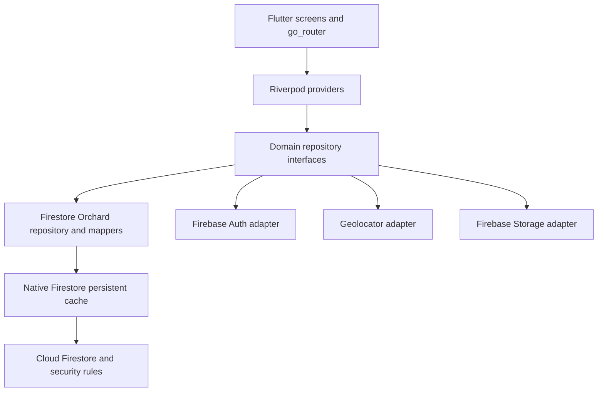

# System architecture

## Stack and boundaries
Flutter Material 3 provides the mobile UI, Riverpod dependency injection and async
state, and go_router navigation. Google Maps renders geographic data. Geolocator
wraps foreground device location. Firebase Authentication supplies account identity;
Cloud Firestore stores property-scoped records with native offline persistence;
Firebase Storage will store private photos. UUID v4 is generated on device before
writes, so IDs remain stable offline and on retry.

`lib/domain` contains Dart entities, validation, taxonomy traversal, aggregation,
and repository contracts. It has no Flutter or Firebase imports. `lib/data`
contains SDK adapters and serialization. `lib/application` composes providers,
auth state, and commands. `lib/ui` observes providers and renders state; it never
calls Firebase. `lib/main.dart` initializes SDKs and configuration at the boundary.

## Routing and state
Routes: `/sign-in`, `/`, `/plants/new`, `/plants/:id`,
`/plants/:id/activity`. Add-another carries a taxon/name template in route extra,
never a mutable plant. Auth gating disposes property streams on sign-out. The
repository exposes snapshot streams with cached and pending flags, plus a stream
of asynchronous write rejections. Controllers handle synchronous validation errors.

## Decisions
- One owner-created default property per account in V1; UUID of that property is
  persisted in a local non-secret preference keyed by UID. A newly reinstalled
  device discovers the property by owner query online. Offline first-ever setup is
  unavailable; this is surfaced instead of inventing a second property.
- Read whole property plant collection for the initial small-orchard slice; do
  viewport/geohash partitioning when collections reach thousands of records.
- Append immutable events instead of mutable totals. Separate event documents
  avoid concurrent activity loss. Record UTC instant AND selected local calendar
  date; the selected date determines harvest year across time zones.
- Native SDK accepts writes locally before server acknowledgement. Do not await
  server completion to navigate offline. Track pending metadata and observe write
  futures for later authorization/rejection errors.
- Local taxonomy is shipped with the app so identification works offline. A future
  remotely managed catalog must version IDs and retain retired entries.

## Operational limits
Firestore persistence covers documents, not map tiles, auth registration or photo
uploads. Offline queries only return cached documents; cache status must not imply
completeness. Firebase initialization failures render setup guidance. Production
configuration is injected using ignored local files/dart defines. Emulator mode is
explicit and never inferred from a failed production connection.
