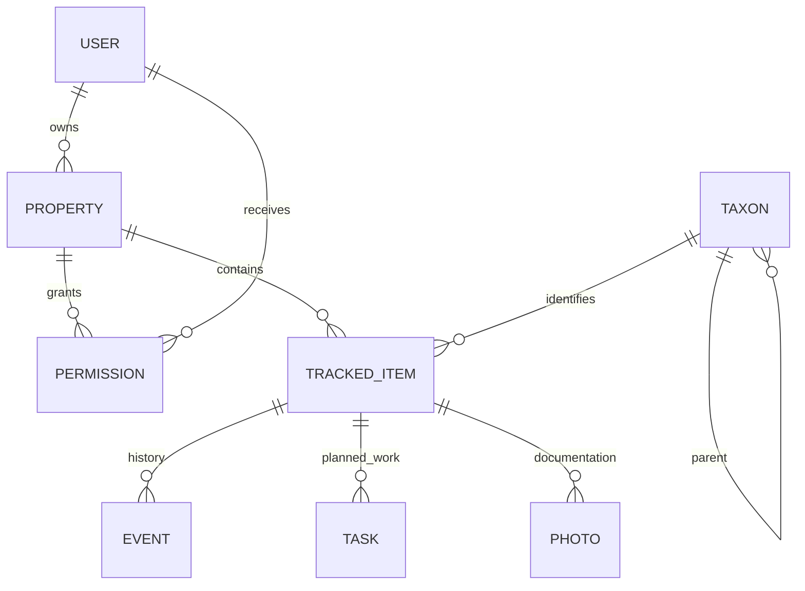

# Domain and data model

| Concept | Identity and attributes | Relationships / invariants |
| --- | --- | --- |
| Property/Place | UUID, name, owner UID, createdAt | Security and query scope; later boundaries/address/timezone |
| Taxon | UUID, parentId?, rank, common/scientific name | Tree: group → genus → species → cultivar; no cycles; parent exists; IDs immutable |
| TrackedItem | UUID, propertyId, taxonId, name, coordinates, createdAt | Abstract base for locatable things; WGS84 latitude/longitude must be finite and in range |
| ManagedPlant | TrackedItem + kind=managedPlant | A planted individual; cultivar optional; removal recorded as event |
| ForagingResource | TrackedItem + kind=foragingResource | Future individual or patch, sensitivity and seasonal access metadata |
| Event | UUID, itemId, propertyId, author UID, type, occurredAt, activityDate, recordedAt, notes, harvest? | Immutable append; selected ISO date controls calendar year; positive finite harvest quantity and known unit only on harvest |
| Task | UUID, propertyId, itemId?, dueDate?, assignee?, status | Future planning entity; completion can reference activity event |
| Photo | UUID, propertyId, itemId, eventId?, storagePath, author UID | Metadata independent of binary; future queued upload status |
| User | Firebase UID, displayName? | Authentication ID is supplied by Firebase rather than UUID; avoid duplicating email in field records |
| Permission | propertyId + UID, role (owner/editor/viewer) | Property-scoped role; membership management reserved for owner |

## Activity semantics
Planting, bloom stage, pruning, fertilizing, spraying, pests/disease, watering,
harvest, removal, note and photo are distinct event types. Notes describe bloom
stages, treatments or symptoms in V1; structured treatment fields can be added in a
versioned schema. A removal event preserves historical identity and yield.
The photo event type is reserved until capture/upload is implemented.

Client IDs are UUID v4. A single save uses a single generated ID; retries target the
same document. The activity form disables duplicate taps and generates the event
once per submission. Server rules prohibit editing/deleting events. A later
correction design should append a reversal referencing the original event; V1 does
not claim to support corrections.

## Harvest calculation
Filter event type=harvest and activityDate year=selected year. Sum kg directly,
convert g ÷ 1000 and lb × 0.45359237 to kg; count is a separate dimension. No stored
annual-total field is authoritative. Floating-point totals are rounded for display
only; unit tests use tolerances. Out-of-year events, notes and removals do not
change totals. Validate quantity > 0, finite, at most 10^12 per event (also enforced in rules),
and count quantities integral. Multiple
harvests on one day are legitimate independent events.

Custom `Taxon` records carry a platform-independent `PlantSymbol` identifier. Flutter widgets render that identifier and the Google Maps adapter draws marker bitmaps; domain types contain no Flutter, Firebase, or image-upload APIs. An optional planting date creates a `planting` event, preserving the append-oriented activity model. The plant creation timestamp continues to mean record creation, and yearly harvest totals continue to consider harvest events only.
